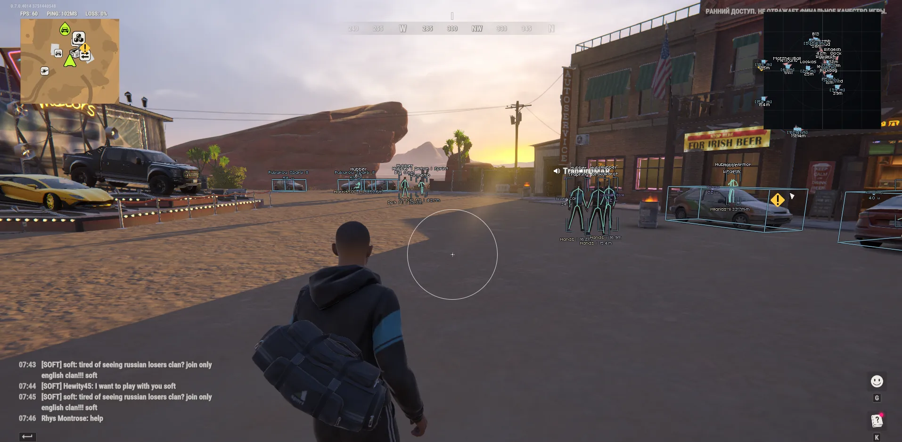

  

 
       

  

━━━━━━━━━━━━━━━━━━━━━━━━━━━━━━━━━━━━━━━

## ⚡ Features

> - Modern and lightweight interface
> - Smart AI-driven system optimization
> - Smooth and optimized performance
> - Clean and structured codebase
> - Continuous updates and improvements
> - Full Windows compatibility

---

## 🖥️ System Requirements

> Windows 10 / 11
> x64 architecture
> Compatible x64 processor
> .NET Runtime

---

## 📸 Preview

